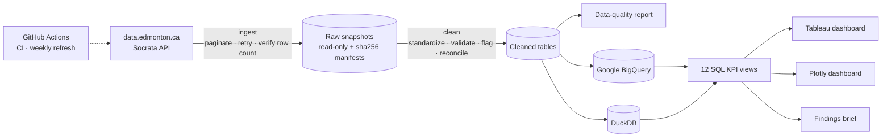
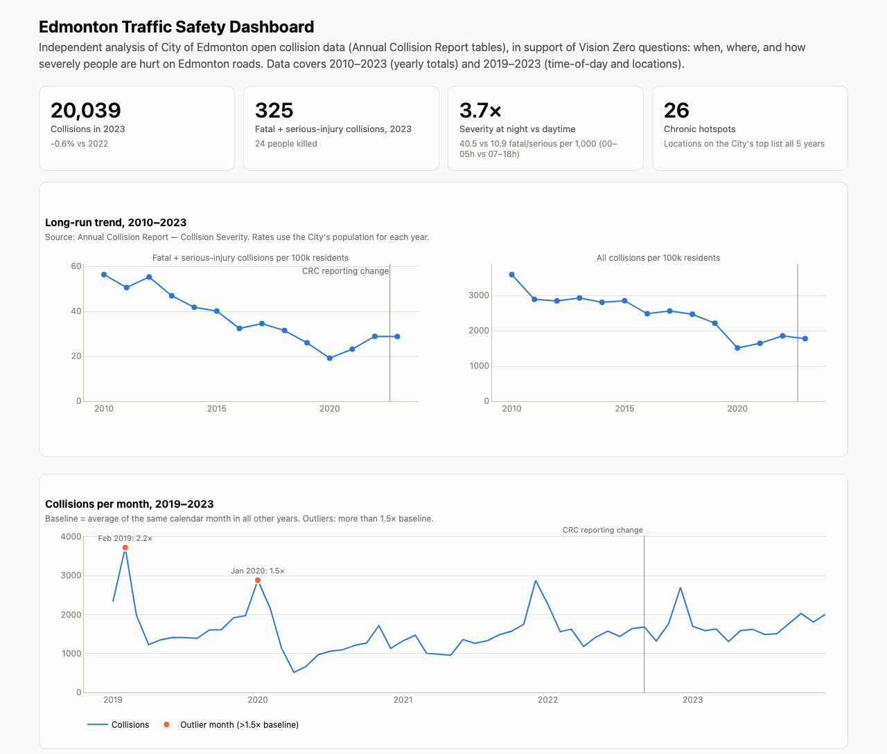
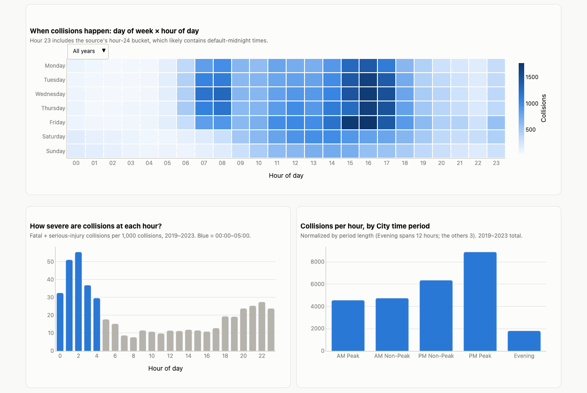
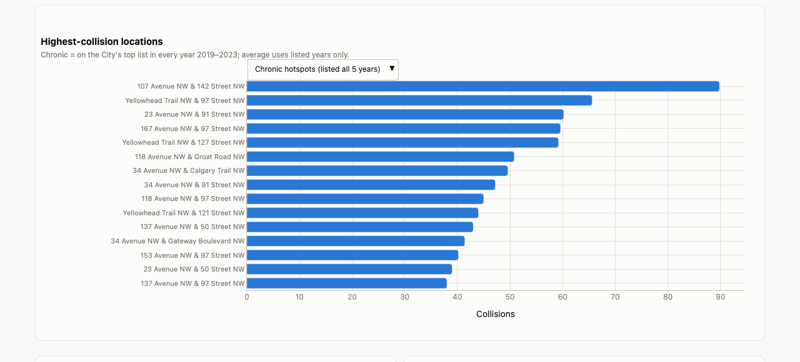
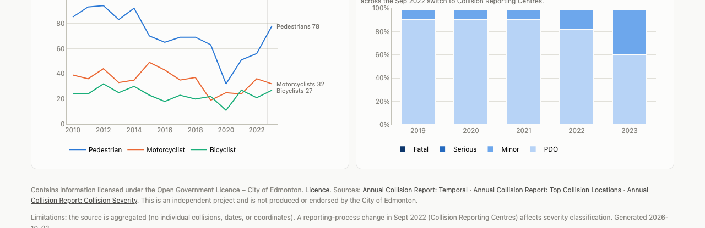

# ZeroPath: Edmonton Traffic Safety Analytics

An automated analytics pipeline built on **real City of Edmonton open collision data** (Annual Collision Report,
2010–2023). It answers the questions a Vision Zero program asks: *when* collisions happen, *where* they keep
happening, and *how severely* people are hurt, with every number traceable to a tested SQL query.

**[View the Tableau Public dashboard →](https://public.tableau.com/app/profile/amitoj.singh4528/viz/ZeroPathEdmontonTrafficSafetyAnalytics/ZeroPathEdmontonTrafficSafetyAnalytics)**

**Stack:** Python · Pandas · SQL · Google BigQuery · DuckDB · Tableau · Plotly · pytest · GitHub Actions

| | |
|---|---|
| Data | 3 City of Edmonton datasets, 19,120 rows, 100% retained after cleaning, 9 of 9 validation checks passing |
| SQL | 12 KPI views deployed to Google BigQuery; the same SQL runs locally on DuckDB with identical results |
| Outputs | Published Tableau dashboard, interactive Plotly dashboard, plain-language findings brief for managers |
| Quality | 90 automated tests, CI on every push, scheduled weekly data refresh |

## Key findings

- **Late-night collisions are 3.7× more likely to be fatal or serious.** Between midnight and 5 a.m., 40.5 of every
  1,000 collisions were fatal or serious, against 10.9 between 7 a.m. and 6 p.m. (95% CI for the ratio: 3.10–4.49).
  The gap appears in every year from 2019 to 2023.
- **The afternoon rush is when collisions are most frequent.** 28% of collisions happen between 3 and 6 p.m., consistently
  every year; the busiest hour of the week is Friday 4–5 p.m.
- **The same intersections keep appearing.** 26 locations were on the City's top-collision list in all five years,
  accounting for 5,503 collisions. 107 Avenue & 142 Street reached 169 collisions in 2023, the highest in the data.
- **Serious harm per resident fell for a decade, then rose.** Fatal and serious collisions per 100,000 residents went
  from 56.4 (2010) to 19.2 (2020), then back up to 28.8 (2023).

The full brief, with recommendations and limitations, is in [reports/findings_brief.md](reports/findings_brief.md).
Every figure in it is produced by a named query in [sql/analysis/findings.sql](sql/analysis/findings.sql), with live
results in [reports/findings_evidence.md](reports/findings_evidence.md).

---

## How it works



1. **Ingest.** Pulls the three tables from the City's open data API with pagination and retries. Each download is
   checked against the API's own row count (the API once returned an empty page, which would otherwise have silently
   truncated the data) and saved as a read-only snapshot with a SHA-256 manifest, so every run is auditable.
2. **Clean and validate.** Standardizes, validates and flags the data, then reconciles it against the City's published
   totals. Every rule records how many rows it touched, and [reports/data_quality.md](reports/data_quality.md) is
   generated from that record.
3. **Model in SQL.** Loads the cleaned tables into Google BigQuery and builds 12 KPI views. The SQL is written once and
   also runs on DuckDB; all 12 views return identical results on both engines.
4. **Report.** The views feed a published Tableau dashboard, an interactive Plotly dashboard and a findings brief.
5. **Automate.** GitHub Actions runs the test suite on every push and refreshes the data every Monday, committing
   only when the KPI outputs actually change.

## Data

| Dataset | Rows | Coverage | Used for |
|---|---:|---|---|
| [Annual Collision Report: Temporal](https://data.edmonton.ca/d/jduq-w5pj) | 18,545 | 2019–2023 | Collisions by year × month × day of week × hour × severity |
| [Annual Collision Report: Top Collision Locations](https://data.edmonton.ca/d/mf6n-s5ts) | 561 | 2019–2023 | Top ~50 intersections and midblocks per year |
| [Annual Collision Report: Collision Severity](https://data.edmonton.ca/d/77sf-j5rj) | 14 | 2010–2023 | Yearly totals, injuries and fatalities by road user, population |

The tables are **aggregated**: the City publishes counts, not individual collision records, so there are no exact
dates or coordinates.

**Licence:** [Open Government Licence – City of Edmonton](https://data.edmonton.ca/stories/s/City-of-Edmonton-Open-Data-Terms-of-Use/msh8-if28).
*Contains information licensed under the Open Government Licence – City of Edmonton.* This is an independent analysis;
it is not produced or endorsed by the City of Edmonton.

## Data quality

The guiding rule: **drop a row only if it can't be used at all; flag everything else**, so the cleaned totals still
reconcile with the City's published figures. Result: 19,120 rows ingested, 19,120 retained, 796 flagged with a
documented reason, and the time-of-day totals match the City's yearly totals **exactly** for every year and severity level.

The hardest problems the data presented:

- **A reporting-process change that looks like a safety trend.** In September 2022, Collision Reporting Centres
  replaced police reports. Minor-injury collisions rose from 8% to 38% of the total between 2021 and 2023 while total
  collisions stayed flat. That is a classification change, not a change in road safety, so every row carries a
  `reporting_period` and minor-injury trends are never compared across the break.
- **A severity label that changed name.** "Serious" became "Major" in 2020. The two were merged only after confirming
  the counts match a second City table exactly in every year.
- **Locations that change name between years.** Labels, typos, abbreviations and street order all vary. Names are
  normalized from an explicit correction list (no fuzzy matching, which can merge different places), giving 313 raw
  names → 310 locations. A site missing from a year's top-50 list is treated as *unknown*, not zero.
- **Odd time coding.** Hours run 0–24, and hour 24 holds an unusual spike that likely contains unknown times recorded
  as midnight. It is flagged and kept out of the late-night findings.

## KPIs

All KPIs are SQL views in [sql/views/](sql/views/), each documented in its file header.

| View | What it measures |
|---|---|
| `v_kpi_annual_summary` | Yearly totals, fatal + serious collisions, people killed or seriously injured, rates per 100,000 residents, year-over-year change |
| `v_kpi_monthly` | Monthly collisions against the same month in other years; months above 1.5× flagged as outliers |
| `v_kpi_month_hour_drilldown` | Hour-by-hour profile of each month, to explain outliers |
| `v_kpi_day_hour` | Day of week × hour of day (heatmap) |
| `v_kpi_hourly` | Each hour's share of collisions and its fatal + serious rate per 1,000 collisions |
| `v_kpi_hour_group` | Collisions per clock hour in each of the City's time periods |
| `v_kpi_day_of_week` | Collisions and severity by weekday |
| `v_kpi_severity_trend` | Severity mix by year |
| `v_kpi_top_locations` | The City's top-collision list per year, consistently ranked |
| `v_kpi_location_persistence` | Chronic hotspots: years on the list and average collisions per listed year |
| `v_kpi_vulnerable_road_users` | Pedestrians, cyclists and motorcyclists killed or injured per year |
| `v_kpi_intersection_midblock` | Injuries and fatalities at intersections vs midblock |

**Not built, because the data can't support them:** daily trends (no day-of-month field), maps (no coordinates),
collision rates per traffic volume (counts don't join to locations), severity by location, and weather effects.

## Dashboards

**Tableau Public:** [ZeroPath: Edmonton Traffic Safety Analytics](https://public.tableau.com/app/profile/amitoj.singh4528/viz/ZeroPathEdmontonTrafficSafetyAnalytics/ZeroPathEdmontonTrafficSafetyAnalytics):
late-night severity, the long-run trend, chronic hotspots, the severity mix and a day × hour heatmap. It is fed by
the KPI extracts in [tableau/](tableau/), so its numbers match the SQL exactly.

**Plotly** ([dashboard/index.html](dashboard/index.html)): KPI tiles, long-run trends, monthly outliers with a
drill-down, the day × hour heatmap, severity by hour, location rankings and vulnerable road users.






## Testing and automation

- **90 automated tests** cover ingestion, every cleaning rule, the data-quality checks and every KPI view. They run on
  small hand-built fixtures with expected values checked by hand, and network access is blocked inside the suite.
- The tests caught real bugs before release, including a crash on new location labels, two KPIs dividing by the
  wrong denominator, and a pandas 3 change that silently skipped text cleaning.
- **CI** runs the suite on every push on Python 3.11, 3.12 and 3.13.
- **A weekly refresh** re-pulls the City data, re-runs the full pipeline and commits only when the KPI outputs change.
  Raw snapshots are archived as build artifacts for auditing.

## Limitations

- The data is aggregated, so causes, exact locations and contributing factors can't be analysed.
- There is no traffic-volume measure, so hotspots partly reflect how busy a road is, not only how risky it is.
- 2020 was a pandemic year and is a poor baseline.
- The City's tables currently end at 2023.

## Repository layout

```
src/traffic_safety/   ingest, clean, quality, load (BigQuery + DuckDB), dashboard, findings, pipeline
sql/views/            12 KPI views
sql/analysis/         named queries behind every number in the findings brief
tests/                test suite and fixtures
tableau/              KPI extracts that feed the Tableau dashboard
reports/              data-quality report, findings brief, findings evidence
dashboard/            Plotly dashboard
```

---
*Amitoj Singh Gill · [GitHub](https://github.com/gill-amitoj)*
